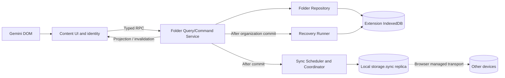

# Folders Background 数据架构

> 实现边界：Background 持有 Repository、IndexedDB、恢复点和 Browser Sync 调度。完整快照协议见 [Browser Sync V4](./browser-sync-data-architecture.md)，普通事务与独立后台任务见 [提交后任务](./post-commit-task-architecture.md)。Folder 尚未上线，不实现历史数据迁移；Google Drive 和 provider 切换未实现。

## 1. 所有权与数据链路



- IndexedDB 在扩展 origin，数据库为 gemini_extension，不在 Gemini 网页 origin。
- Content 不 import Dexie、Repository、Sync Coordinator 或具体 provider，只管理页面身份、DOM 和临时交互。
- Background 校验 RPC、账号、sender 和业务约束，执行持久化及同步/恢复。
- UI 按场景分页读取。完整账号数据只供后台同步、备份、导入、导出和恢复使用。
- 本地事务成功后回复用户，Sync 与普通自动 Recovery 独立推进。后台任务失败不能把已提交的用户修改描述成未保存。
- storage.sync 是本机可见副本；浏览器负责跨设备传输。读写成功不证明云端上传或其他设备收到。

## 2. 账号范围

所有后台读写显式带 accountScopeId。相同规范化邮箱的 observed 与 manual-confirmed 使用同一范围。身份不明确时页面不读取或显示账号数据；切换账号先卸载旧投影及临时状态，再加载新范围。

RPC 只接受当前扩展的 Gemini content sender，校验固定 namespace、protocolVersion、method、params 和 identitySource。范围检查同时覆盖输入行、既有 ID、父节点、成员关系、快照、同步 Manifest 和固定分块清理。全局主键下已有其他账号 ID 的记录不能被 bulkPut 覆盖。

邮箱和账号快捷历史只保存在本机账号历史 storage.local 项，不进入组织 payload。scope 哈希不是安全认证；手动确认不验证 Gemini 登录身份。

## 3. 持久表

精确结构和索引以 src/data/db.ts 与 src/domain/folder/types.ts 为准。共享数据库中非 Folder 表及其历史版本保持原样；未发布的 Folder 只定义当前模型，不做数据格式迁移。

| 表 | 职责 |
| --- | --- |
| folders | 当前有效 Folder、父级、外观、顺序及时间 |
| folder_memberships | 当前 Folder/Chat 关系、普通和置顶顺序 |
| folder_chat_references | 每账号/Chat 唯一标题缓存，仅保留被引用资料 |
| folder_settings | 同步开关及本机收起状态 |
| folder_sync_states | 本机修订、基准快照、dirty、失败/重试和容量事实 |
| folder_sync_publications | 每账号至多一份捕获的待发布快照 |
| folder_sync_conflicts | 每账号至多一份完整验证后的冲突候选 |
| folder_snapshots | 有数量/容量上限的本地组织恢复点与保护租约 |
| folder_recovery_states | 自动分组、pendingRevision 及恢复失败事实 |
| folder_coordinator_leases | 同设备每账号同步租约 |

删除 Folder 子树和 membership 时物理删除记录，并在事务中清理无人引用的 Chat reference。没有永久 tombstone、字段合并戳、Outbox operation 或接受发布历史。导入/同步数据始终校验树结构、账号、唯一关系及引用完整性。

## 4. 本地事务与后台任务

组织修改在同一事务提交业务行、localDataRevision、dirty 和 Recovery pendingRevision。同步开关修改也推进同步修订及 dirty；本机收起状态不 dirty，不生成组织恢复需求。

Repository 返回数据和 FolderCommit。Command Service 将 commit 交给普通 after-commit 分发函数，分别唤醒 Sync 和 Recovery。Recovery 失败不会阻塞 Sync，Sync 失败也不会撤销组织提交。

不在同步租约中串行化用户编辑，因而同步应用和发布确认还必须检查捕获修订：

```text
捕获 R1 → 用户提交 R2 → 完成 R1 的后台工作
  → 不能把 R2 标为已发布
  → 不能用 R1 的接收结果覆盖 R2
  → 持久需求继续保留，安排下一轮
```

Recovery 沿用独立、单执行槽、分页扫描及账号轮换机制；保存捕获的组织状态并只完成对应 pending，旧成功/失败不清除新需求。普通恢复失败结束本次尝试，等待下一次外部唤醒或手动创建；Sync 使用现有失败 alarm。

## 5. RPC 查询与命令

查询保持只读；没有 settings 行时可以返回默认投影，首次实际命令再初始化持久状态。普通页面加载、刷新及只读查询不生成组织修订、恢复点或待发布快照。初始化同步工作由单独的 activity hint 触发。

主要查询包括 getSidebarState、listFolders、listFolderChats、getPickerOptions、resolveChatMemberships、getFolderDeleteImpact、getSettings、getSyncStatus、listSnapshots、getRestoreImpact、exportBackup，以及显式容量测量。Sidebar 首批最多 5 个 Folder，每个 Folder 首批 10 个 Chat；后续按固定顺序 cursor 加载，不能每次分页全量镜像账号。

命令提交完整意图，包括 Folder 创建/编辑/移动/子树删除、membership 加入/移动/置顶/移出、标题更新、设置、备份导入、恢复和保护点。顺序使用相邻实体 ID，repository 事务内求 orderKey；UI 不生成任意持久排序键。

稳定 membership ID 与唯一约束保证重复加入为 no-op。规范化标题未变化不生成额外组织修改。重命名、编辑及破坏性动作必须检查对象属于当前账号、仍存在，并检查对应捕获版本；旧草稿不能覆盖同步收到的更改或重建删除对象。

retrySync 返回完成的本机尝试结果。resolveSyncConflict 带 choice、expectedRevision 和 snapshotId；后台重新读取候选和存储副本后决定，不把 UI 选择当成未经校验的覆盖授权。

协议和错误类型以 src/domain/folder/rpc.ts 为准。业务提交之后的查询/通知错误返回通用状态错误，不鼓励重复执行已经提交的动作。只有实际业务保存失败才使用 FOLDER_SAVE_FAILED；手动恢复点失败单独分类。

## 6. Browser Sync 决策

同账号任务串行，持久 lease 与修订检查分别保护 job 重入和用户并发编辑。启动、账号活动、focus、online、业务提交、storage.onChanged、Retry 和 alarm 提供唤醒；普通状态不轮询。

每次 Background 初始化都先注册监听，再并行发现 storage.sync 已有账号和 IndexedDB 本地待处理工作，不依赖打开 Gemini 或 runtime.onStartup。浏览器启动复用同一入口；重叠扫描合并，完成释放，扫描失败不影响本地恢复和 RPC。发现仅提交 scope，Coordinator 重新读取校验快照。

完整验证后的收到快照与本机基准比较：clean 接收并整体替换；dirty 且仍是基准则发布本机；dirty 遇到不同快照保存冲突并暂停覆盖。接收不取实体并集，不以时钟大小排序。

收到缺块、混合 snapshotId、hash/schema/账号/引用错误时，组织与同步设置均保持本机状态。有效空快照与存储缺失不同；已有基准而 Manifest 消失不自动重种入旧数据。

本机干净、无基准且无 Manifest 时等待数据，不发布默认空快照。只有真实修改或持久待发布任务才能进入发布流程。Key 固定为 folders:{accountScopeId}:manifest / chunk:{index}，格式版本只放在 value。未知 schemaVersion 保留两端数据并提示升级；所有发布/冲突入口都阻止覆盖，清理旧重试 alarm。

固定账号 key 保存单份完整状态。写入中断可以暂时让同步区不可读，本机数据及每账号一份持久 publication 用于恢复；重试复用相同内容/ID。多余尾块清理限定当前账号，配额预检计算全部账号及其他扩展数据。

两种冲突选择都重新校验本机修订和当前收到快照，丢弃任一组织状态前保留两份有上限的恢复点。保护失败则保持原组织和冲突。恢复点存组织，不回滚设置；冲突候选另保存同步设置。

## 7. 页面通知与草稿

folders:data-changed 只用于 Background → Content 的投影失效通知，不驱动再次发布。状态变化只刷新 syncStatus；组织或设置变化刷新相应投影。

监听在账号识别和首次投影读取前注册。读取期间的通知合并为当前账号的一次后续读取；切换账号及停止时丢弃旧标记，避免恢复提交发生在初读期间时长期显示空列表。

接收同步不能关闭当前同账号编辑界面或丢弃用户输入。草稿保留捕获版本，保存前后台在业务写事务内检查；版本变化后提示重新查看，输入留在原界面。账号切换仍清理旧账号临时状态。

Retry 和冲突选择的异步反馈绑定发起账号、面板状态及请求身份。正常状态安静，不展示无法验证的云端进度。容量查询只是测量，不清除错误或确认同步。

## 8. 恢复、资源和平台

恢复点压缩使用原生异步 gzip，正文以 ArrayBuffer 存入 IndexedDB，payloadBytes/contentHash 对应二进制。Browser Sync v4 使用 gzip + Base64，字节数/hash 对应传输字符串；压缩、解压、hash 在事务外执行，publication 保存前仍重新核对捕获视图。缺少原生接口时保留 pending/dirty 并报告失败，不回退压缩库，不把接口缺失标为正文损坏。

本地恢复点每账号最多 10 个、全扩展共用 20 MiB 逻辑预算，保留自动分组、组织 hash 去重与保护租约。删除/导入/恢复/同步覆盖前的保护点失败阻止破坏性操作；普通自动点失败不撤销提交。

同步内存槽结束时释放，活动节流/缓存有容量或 TTL。publication 与 conflict 每账号单行，没有历史增长；alarm 与租约结构化按账号标识。保护租约过期可回收，不依赖常驻进程。

Chrome MV3 后台可以随时停止；Firefox 使用共享后台入口，均以持久事实为准。浏览器差异和 required unlimitedStorage 见 docs/platforms.md；权限不增加恢复点产品预算或同步配额。

## 9. 验证边界

必要测试覆盖物理删除/重加、排序和账号/树约束；完整替换且旧 clean 数据不重新发布；空/缺失/损坏和设置原子性；冲突选择与保护失败；发布期间新编辑；断写/重启；配额预检和固定尾块清理；有界状态、无自激发布循环、旧草稿和真实 Retry 结果。

TypeScript、Vitest 与 Chrome/Firefox 构建独立验证源码与生成物。真实页面需确认加载本次代码；跨设备同步必须由两个设备实际读回，不由本机 storage.set 成功、旧安装或构建通过推断。
