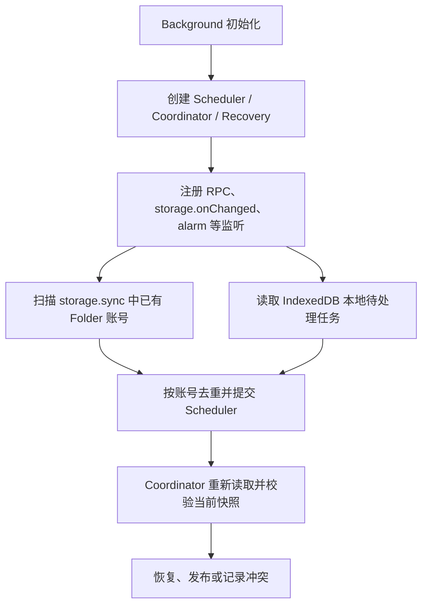

# Folder Browser Sync 主动恢复与固定 Key 改造方案

状态：已实施；工程检查与真实浏览器验收分别记录，跨设备到达仍须两台设备读回。

## 1. 背景与目标

当前实现采用 V4 全量快照：干净设备恢复完整远端快照；本地有未提交修改时，根据远端是否仍为本地基线决定发布或记录冲突。

改造前同步 key 已按账号固定，但仍包含 `v4`：

```text
folders:v4:{accountScopeId}:manifest
folders:v4:{accountScopeId}:chunk:{index}
```

改造前 Background 初始化只恢复 IndexedDB 中的待处理同步任务。扫描已有 Browser Sync key 的逻辑位于 `runtime.onStartup`，首次安装或普通 worker 激活时没有主动发现同步存储中的账号。当前已使用第 3 节的统一入口。

Folder 尚未发布，因此本次不迁移未发布实验 key。上线后的旧格式读取、无损升级和多版本设备数据保护是强制约束，不适用此开发阶段例外。

改造目标：

- 新安装后，即使未打开 Gemini，也能发现 `storage.sync` 中已有的 Folder 数据并恢复到 IndexedDB。
- Background 重新启动时，重新发现同步数据，并恢复本地待处理任务。
- Gemini 页面先展示本地数据，后台恢复完成后自动更新。
- Key 长期固定；数据格式通过 value 中的 `schemaVersion` 标识。
- 沿用现有账号隔离、快照替换、冲突判断、恢复点保护和容量限制。

相关现有实现：

- [Background 初始化](../../../src/entrypoints/background/folders/index.ts)
- [Browser Sync Provider](../../../src/services/folder-sync/providers/browser-sync.ts)
- [同步调度器](../../../src/services/folder-sync/scheduler.ts)
- [同步协调器](../../../src/services/folder-sync/coordinator.ts)
- [页面 FolderRuntime](../../../src/entrypoints/content/folders/runtime.ts)

## 2. 固定 Key 与数据结构

### 2.1 Key

去掉 key 中的版本号，保留账号隔离和固定分块：

```text
folders:{accountScopeId}:manifest
folders:{accountScopeId}:chunk:{index}
```

同一账号的 manifest 始终使用相同 key；快照更新时覆盖固定分块，快照缩小时清理同账号多余尾块。

不重新引入按批次增长的 key，也不长期保留第二份同步快照。

### 2.2 Value

Manifest 保持当前 V4 格式：

```ts
interface BrowserSyncManifest {
  schemaVersion: 4
  accountScopeId: string
  snapshotId: string
  baseSnapshotId?: string
  chunkCount: number
  payloadBytes: number
  payloadHash: string
  settings: {
    enabled: boolean
    hideOrganizedChats: boolean
  }
}
```

每个分块的 value 保持：

```ts
interface BrowserSyncChunk {
  snapshotId: string
  payload: string
}
```

保留 `snapshotId` 校验，防止固定分块覆盖或分批到达时混用不同快照。

本次只改变存储位置，数据格式仍为 `schemaVersion: 4`。以后格式升级时调整 schema 与解析逻辑，key 保持不变。

### 2.3 统一 Key 操作

Key 的生成、识别、账号提取、分块前缀及尾块清理集中使用同一组辅助函数，覆盖：

- Provider 读取和发布。
- Background 启动发现。
- `storage.onChanged` 账号提取。
- 容量统计与预检。
- 同账号多余尾块清理。
- 测试工具及 fixtures。

账号格式和分块索引继续严格校验，不跨账号清理，不调用 `storage.sync.clear()`。

### 2.4 开发数据处理

本次不实现旧 V3/V4 key 的读取、转换或迁移，也不添加运行时旧 key 自动删除逻辑。

开发环境已有的旧 key、相关本地基线和待发布测试数据，可在测试前按需手动重置。旧 key 若保留，仍占用浏览器总同步配额，不能在容量检查中忽略。

## 3. Background 主动发现与恢复

### 3.1 启动顺序



先注册监听，再启动异步恢复任务。扫描和恢复不能阻塞 RPC 服务或页面初始化。

### 3.2 同步账号发现

启动发现任务执行一次 `storage.sync.get(null)`：

1. 识别固定 manifest 和 chunk key，提取合法 `accountScopeId`。
2. 按账号去重，每个账号只调度一次。
3. 将账号交给现有 Scheduler。
4. Coordinator 重新读取当前 manifest 和分块，完成全部校验后恢复。

扫描结果只用于发现账号，不能直接作为已验证快照写入 IndexedDB。扫描结束到实际恢复之间，同步存储可能已经变化。

仅有 chunk、尚无 manifest 的账号也应被发现，但不能因此创建空同步快照。

发现和校验版本分别处理：发现阶段不能因为 manifest 的 schemaVersion 不受支持就忽略账号，必须让读取流程明确识别并保护未知格式。

### 3.3 本地待处理任务恢复

继续读取 IndexedDB 中的 dirty 状态、待发布快照和重试事实，复用现有调度与租约机制。

同步存储扫描和本地任务读取相互独立；一项失败不能取消另一项。相同账号的重叠请求交由 Scheduler 合并，执行中的新请求仍保留必要的后续检查。

### 3.4 生命周期入口

统一启动恢复入口在以下时机使用：

- 每次 Background 初始化，包括新安装与 worker 被重新唤醒。
- 浏览器 `runtime.onStartup`。

重叠调用合并为一次进行中的扫描。扫描结束后清理进行中的 Promise，避免永久缓存阻止后续恢复。

无需额外建立 `onInstalled` 恢复算法；首次安装执行 Background 初始化，使用同一入口。

### 3.5 后续到达与失败

- 保留现有 `storage.onChanged`，manifest 和 chunk 变化均按账号调度。
- 启动扫描时尚未到达的数据，由后续存储事件触发恢复。
- 扫描失败记录错误，不影响 RPC、本地任务和后续事件处理。
- 缺块、损坏、租约繁忙等账号级任务沿用现有持久重试机制。
- 正常运行期间不增加固定间隔的全量轮询。
- 进行中的扫描和临时账号集合在任务结束时释放；正确性不依赖 worker 内存一直存在。

## 4. Coordinator 恢复与发布规则

复用现有 Coordinator，不新增一套独立的数据恢复算法。

| 同步存储与本地状态 | 行为 |
| --- | --- |
| 完整快照，本地干净 | 校验并保护本地数据后，原子替换组织和同步设置 |
| 快照 ID 与本机基准相同，但干净本机内容不一致 | 对比完整组织和同步设置后恢复，防止部分清理残留的基准阻止恢复 |
| 完整快照，本地 dirty，远端仍为本地基线 | 沿用现有发布流程 |
| 完整快照，本地 dirty，远端已变化 | 持久化冲突，保留本地数据，等待用户选择 |
| 有效空快照 | 正常恢复，表示用户清空了 Folder |
| 无 manifest，本地无修改、无待发布快照、无基线、无冲突 | 安静结束，不发布空数据，等待后续存储变化 |
| 无 manifest，本地有真实待提交修改 | 沿用发布前完整性检查；残留分块不能被误覆盖 |
| 已有基线但 manifest 消失 | 保留本地，报告缺失并安排重试 |
| 缺块、混合快照或损坏 | 不应用组织和设置，保留本地并沿用重试机制 |
| 不支持的 schemaVersion | 保留本地和同步存储，停止自动应用与覆盖 |
| 明确记录的自身发布中断 | 沿用当前待发布快照和 writing 标记恢复流程 |

### 4.1 限制空发布

改造前代码在“无 manifest、无本地基线”时允许自动发布初始快照。当前初始化默认设置或发现账号本身不能构成发布理由。

只有真实待提交修改或已持久化的待发布事实，才进入相应发布流程。未观察到同步数据不等于用户明确清空数据。

此限制覆盖启动发现、页面 activityHint、存储事件及后台恢复，避免某个入口绕过规则。

没有数据且本地干净时，不标记“已恢复”，也不因为正常缺失持续安排重试。后续存储变化仍可唤醒该账号。

### 4.2 保留现有完整性边界

恢复前继续验证：

1. Manifest 格式、版本和账号 scope。
2. 分块格式、索引、数量和 snapshotId。
3. 拼接 payload 的 UTF-8 字节数及 SHA-256。
4. 解压、JSON 和组织 schema。
5. 唯一 ID、Folder 树和聊天引用约束。
6. 读取期间 manifest 未变化。

完整验证后，继续使用本地修订检查、恢复点保护和 IndexedDB 原子事务。校验或保护期间产生新修改时重新评估，不能覆盖用户的新编辑。

## 5. schemaVersion 与未知格式保护

固定 key 后，旧插件可能看到未来版本写入的数据。读取分为两个阶段：

```text
读取基本 envelope，识别 schemaVersion
    ↓
版本受支持：使用该版本的严格 schema 校验
版本不支持：返回明确结果，保留数据并阻止覆盖
```

新增明确的 `unsupported-schema-version` 结果，与不存在、损坏和瞬时读取变化区分。

不支持的版本处理规则：

- 不应用该快照中的组织或设置。
- 不自动发布本地数据覆盖它，包括已有待发布任务。
- 显示需要升级的状态，不进行无意义的持续重试。
- 原有重试 alarm 若再次执行，也必须遵守该保护，不能重新形成持续重试循环。
- 更新插件后，通过启动扫描重新尝试读取。

Provider、Coordinator、发布前检查及同步状态查询须使用一致的分类，避免读取阶段保护后，发布阶段又把未知格式当作不存在。

当前运行时只支持格式 4，未实现实验版本转换。上线后，每次格式升级必须同时交付所有已发布格式的读取/转换能力，覆盖跳版本升级；不能以“只支持当前格式”为由拒绝或清空真实用户数据。完整约束见 [上线后的数据保留与格式演进](./browser-sync-data-architecture.md#9-上线后的数据保留与格式演进)。未知版本保护只是一道安全边界，不代表兼容能力已完成。

当前版本常量 `BROWSER_SYNC_SCHEMA_VERSION` 同时约束 Manifest 类型、严格 schema、版本识别和发布 envelope。固定 key 只保证数据可发现，不代表任意格式天然兼容：破坏性结构变更需递增 value 版本，并明确支持需要保留的旧版本解析/转换，不能通过改 key 绕过兼容决策。

## 6. 页面启动与更新时序

### 6.1 启动顺序

调整 FolderRuntime：

```text
注册后台数据变化监听
    ↓
启动账号识别
    ↓
加载当前账号的本地列表和同步状态
    ↓
发送一次 activityHint
    ↓
后台恢复完成后按通知刷新
```

activityHint 仍只是调度请求；页面启动不等待 Browser Sync 完成。

### 6.2 首次加载期间的通知

若首次加载期间收到当前账号的数据变化通知，记录一次“加载后需刷新”，当前读取结束后补读。

- 标记仅属于当前账号，切换账号和停止 runtime 时清理。
- 连续通知合并，避免同一变化产生大量 Sidebar 查询。
- 只有同步状态变化时，继续只刷新同步状态。
- 没有通知时，不无条件增加第二次完整加载。
- 保留现有分页修订检查和编辑草稿保护。

### 6.3 账号边界

Background 可以按 scope 恢复多个账号的数据；页面仅展示已确认账号的数据。

同步中的账号哈希不能反推出邮箱，也不能用来重建本地账号历史。启动发现不改变自动识别、最近账号、历史账号选择和手动输入的现有身份流程。

## 7. 实施范围与顺序

| 模块 | 改动 |
| --- | --- |
| Browser Sync Provider 与 key helpers | 去掉 key 版本号，统一识别与前缀，更新尾块清理、容量统计和未知 schema 分类 |
| Background 初始化 | 提取统一启动恢复入口，主动发现同步账号，隔离扫描与本地恢复失败 |
| Scheduler / Coordinator | 复用账号去重、串行和重试，限制空发布，保护未知 schema |
| Repository / 同步状态 | 沿用快照原子替换，按需支持未知 schema 状态及本地唤醒条件 |
| FolderRuntime | 提前注册通知监听，处理首次加载期间的通知 |
| 测试及 fixtures | 替换 key，补齐启动恢复、未知版本及通知时序验证 |
| 文档 | 更新同步协议、背景职责和启动时序说明 |

建议实施顺序：

1. 固定 key 与统一识别，同时更新 Provider 测试和 fixtures。
2. 补齐未知 schema 保护和空发布限制，覆盖所有自动入口。
3. 接入统一 Background 启动发现与本地恢复入口。
4. 修正页面监听顺序和首次加载通知处理。
5. 更新架构文档，完成自动化和真实浏览器验收。

不改动现有业务保存、Recovery 独立调度、整份快照冲突选择或容量模型。涉及 locale 文案时，按仓库要求使用项目 `i18n-writer` subAgent。

## 8. 验收标准

### 8.1 自动化测试

| 场景 | 预期 |
| --- | --- |
| 空 IndexedDB，预置完整同步快照，不启动 content script | Background 初始化后恢复到 IndexedDB，`storage.sync.set()` 不被调用 |
| 预置多个账号与多个分块 | 每个账号独立恢复，每轮发现只提交一次账号调度 |
| 已有相同快照重复启动或收到自身通知 | 不重复应用，不反复发布 |
| manifest/chunks 分批到达 | 不应用半份快照；完整后由事件恢复 |
| 无任何同步数据，本地干净 | 不发布空快照，不持续重试 |
| 仅有孤立分块 | 不将其当作已清空，不写入空快照 |
| 有效空快照 | 可恢复并清空原有干净本地组织 |
| 未知 schemaVersion | 本地数据、设置和同步存储保持不变，不自动覆盖或持续重试 |
| 本地 dirty，远端已变化 | 保持现有冲突行为，不静默覆盖或合并 |
| 恢复期间本地产生修改 | 修订检查阻止旧恢复结果覆盖新修改 |
| worker 中断、租约繁忙 | 通过持久事实和重试继续恢复任务 |
| 启动扫描失败 | 本地待处理任务、RPC 和后续存储事件仍可工作 |
| 重叠启动恢复调用 | 合并进行中的扫描，完成后释放临时状态 |
| 页面首次加载期间收到通知 | 最终展示恢复后的列表，无需手动刷新 |
| 多账号、固定分块缩小、容量不足 | 不跨账号清理；尾块可回收；预检失败保留数据 |

### 8.2 工程检查

- 执行相关 Provider、Coordinator、Scheduler、启动集成及 FolderRuntime 测试。
- 执行 `pnpm compile`。
- 若修改 locale，执行 `pnpm run check:i18n`。
- 执行 `pnpm build` 和 `pnpm build:firefox`。
- 检查运行时代码及构建产物不再生成带版本号的 Folder 同步 key；`schemaVersion: 4` 保留。
- 检查差异范围，不覆盖工作区已有的无关改动。

### 8.3 真实浏览器验收

分别验证 Chrome 和 Firefox：

1. 在同步存储预置完整快照，以干净的本地 Folder 数据启动扩展，不打开 Gemini，检查 IndexedDB 已恢复。
2. 打开 Gemini，确认已识别账号直接显示恢复后的 Folder。
3. 模拟同步数据延迟到达，确认事件触发恢复并更新页面。
4. 用两个设备执行写入与另一设备读回，单独验证跨设备到达。

测试、构建和 `storage.sync` API 接受写入不证明云端或其他设备已收到；启动恢复与跨设备传递分别验收。

## 9. 本次验证记录

- 自动化验证覆盖无 content script 的多账号、多分块启动恢复，chunk/manifest 分批到达，扫描失败隔离和重叠调用释放。
- 补测同基准但本机组织/设置被部分清空的恢复；相同内容的重复检查不改修订、不再次发布。
- 覆盖未知格式的读取、发布预检、writing 标记后的重读和旧 alarm 再执行；保留数据和待发布事实，不续排重试。
- 页面初读期间的多条通知合并为一次补读；只有状态通知不多读投影，停止后丢弃待补读。
- 全量 Vitest：118 个文件、896 项通过；TypeScript、i18n 和差异空白检查通过。
- Chrome MV3 和 Firefox MV2 构建通过；两端生成物未生成带版本号的 Folder key，保留未知格式保护及 storage / alarms / unlimitedStorage 权限。
- Chrome 已确认加载开发目录并验证新版本升级提示预览，预览无 Retry。没有删除、改名或预置现有真实同步数据；新固定 key 的真实启动恢复、Firefox 界面及两设备到达仍待现场验收。
