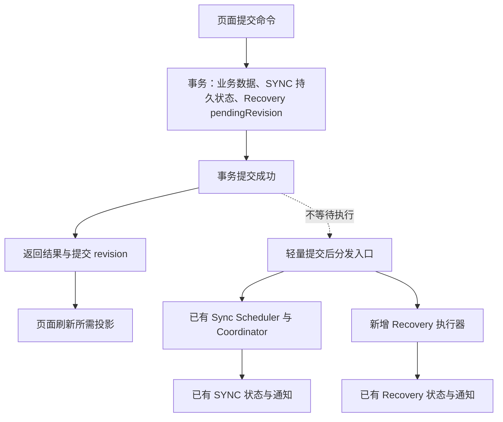

# Folders 本地事务与提交后任务技术方案

> 状态：首版代码已实现，2026-10-13。自动化测试及双平台构建已验证；真实 Chrome 页面尚未确认加载本次构建，页面验证仍待完成。
>
> 目标：普通本地事务提交后即可回复页面；自动 Recovery 与 SYNC 独立执行，并能在后台重启后继续处理。统一数据结构沿用 `FolderOrganizationData`，Browser Sync 已采用 [V4 完整快照协议](./browser-sync-data-architecture.md)，提交后任务的分离、Recovery pending 和有界执行规则保持不变。

## 1. 核心决策

采用：**一个本地事务入口、一个轻量提交后分发入口，复用现有 SYNC 调度器，新增 Recovery 执行器。**

- 业务数据与待处理需求一起持久化。SYNC 使用 dirty、本机修订与每账号一份 publication/conflict；Recovery 仅在已有 `folder_recovery_states` 增加 `pendingRevision`。
- 普通修改的成功边界是本地事务提交。回复页面不等待自动恢复点、同步、广播完成或 alarm 创建。
- 提交后分发入口只负责唤醒，不查询完整数据、不执行任务、不保存任务队列、不统一业务重试。
- 连续修改由各执行器合并；后台中断后分别从各自的持久状态恢复。
- 不新增通用任务表、通用任务状态机或新的 SYNC 待处理副本；移除仅为耗时测量增加的回调和计时上下文，保留流程执行日志。
- 保留数据与 revision 原子读取、Recovery 条件完成、SYNC 条件合并等必要的一致性保护。
- Recovery 第一版不增加持久失败版本、退避字段或重试 alarm；失败不自行启动下一轮，后续修改、手动创建恢复点或后台重新激活时再评估。

## 2. 优化前路径与当前路径

以首次将 Chat 加入已有 Folder 为例，优化前路径为：

```text
写 membership、chatReference、dirty、localDataRevision
  → 提交事务
  → await 自动 Recovery（查询、压缩、hash、写快照）
  → Repository 返回
  → 请求 SYNC
  → RPC 重新读取 revision 并回复页面
```

优化前的源码定位（用于说明原有等待关系，行号不代表当前实现）：

| 位置 | 当前职责与问题 |
| --- | --- |
| `src/data/repositories/folderRepository.ts:806` | 新增 membership 的原始事务 |
| `src/data/repositories/folderRepository.ts:890` | 现有耗时统计回调，实施时移除；提交结果改由事务返回值表达 |
| `src/data/repositories/folderRepository.ts:898` | 提交后等待自动 Recovery |
| `src/data/repositories/folderRepository.ts:1118` | Recovery 分别读取数据与 revision |
| `src/data/repositories/folderRepository.ts:1276` | 从已有持久事实恢复 SYNC 工作 |
| `src/entrypoints/background/folders/command-service.ts:136` | Repository 返回后才请求 SYNC |
| `src/entrypoints/background/folders/rpc-handler.ts` | 命令完成后读取当前 revision，再返回 RPC |
| `src/services/folder-sync/scheduler.ts` | 运行合并、activityHint 限流和 retry alarm，继续复用 |
| `src/services/folder-sync/coordinator.ts:172` | 读取、合并、写回之间缺少本地 revision 条件检查 |



独立推进表示没有互相 `await`；同一后台 JS 线程和 IndexedDB 仍可能产生资源竞争。

## 3. 本地事务入口与触发策略

使用 Folder 范围内的 `runFolderMutation` 小型封装，负责事务表集合、Recovery 待处理标记和提交结果；不接管领域校验、版本戳、排序或 SYNC 算法。

```ts
type FolderMutationEffect = 'organization' | 'sync-settings' | 'local-view'

interface FolderCommit {
  accountScopeId: string
  dataRevision: string
  effect?: FolderMutationEffect
}

interface FolderMutationResult<T> {
  data: T
  commit: FolderCommit
}

// Conceptual API; the callback runs inside the IndexedDB transaction.
runFolderMutation(accountScopeId, tables, async () => {
  // Validate and write rows; writeOperation advances the data revision.
  return result
})
```

封装统一包含业务表、`folder_sync_states` 和 `folder_recovery_states`。`markOrganizationChanged` 维护账号 dirty 和 revision；封装比较事务前后 revision 判定组织变化，读取最终 revision 并更新 Recovery pendingRevision，随后一起提交。设置方法通过在事务内求值的 effect resolver 区分同步设置、本机视图变化和无修改，不借助测量回调。一次命令的内部重平衡可以更新多行业务数据，但只更新一次 Recovery 标记。

| 实际 effect / 入口 | 持久需求与提交后唤醒 |
| --- | --- |
| `organization` | 已有 SYNC 状态；更新 Recovery pendingRevision；唤醒两者 |
| `sync-settings` | 账号 revision 与 dirty；只唤醒 SYNC |
| `local-view` | collapsed 等本机状态；不唤醒这两项任务 |
| effect 为 undefined | 无实际修改；不新增待处理需求 |
| 远端合并确实改变本地组织数据 | 在合并写回事务内更新 pendingRevision；提交后唤醒 Recovery；SYNC 发布仍由当前 Coordinator 决定 |
| 普通查询／页面刷新 | 不创建 revision、待发布快照或恢复点 |

组织修改包括 Folder、membership、pin、标题缓存及导入／恢复后的替换。独立标题补写也纳入组织修改；同值补写不创建修订或新需求。

effect 根据实际写入决定，不只看方法名或传入字段。settings patch 仅改变收起状态，即使携带值未变化的 `enabled`，也只返回 `local-view`。同步设置推进账号 revision 和 dirty，但不产生组织 Recovery 需求，不能借用 Recovery 标记。

## 4. 复用持久状态与 Recovery 待处理标记

### 4.1 SYNC 保持已有状态

SYNC 使用账号 dirty、prepared/writing publication、conflict，以及 `folder_sync_states.retryAt/retryCount`。`listBrowserSyncWakeScopes()` 从这些持久事实恢复工作，每账号最多一份 publication 和冲突候选，不将 Recovery pending 当作 SYNC 需求，也不统一两个任务的重试字段。

### 4.2 Recovery 只补充一个待处理标记

现有账号状态记录分组与 warning，没有表达“事务已经提交，但自动恢复点尚未完成”的字段。只增加一个可选标记，快照读取、压缩、去重、分组和预算逻辑继续复用：

```ts
interface FolderRecoveryStateRow {
  // Existing account scope, grouping and warning fields remain unchanged.
  pendingRevision?: string
}
```

`pendingRevision` 取产生需求的组织事务 revision；连续修改覆盖同一字段，每账号仍只有一条状态。它用于识别待处理需求，不要求一直等于当前 `localDataRevision`：SYNC 可以只改变本地 revision 而不改变组织内容，此时不迁移标记、不创建新需求。执行器分别捕获 pending 标记和数据 revision，再按捕获的 pending 标记条件完成。

revision 是不透明身份，只做相等比较。不保存逐操作队列、完整 payload、requestToken、通用 state 或永久任务历史，也不为 Recovery 复制 SYNC 的重试状态。

新增可选字段不要求新增表或索引，当前 Dexie v12 可继续存储；仅当实施确需新索引时增加 schema 版本。不增加旧 Folder 文件格式兼容，也不清理其他功能数据。

## 5. 轻量提交后分发与扩展入口

增加普通函数 `dispatchFolderAfterCommit`，执行两个明确的非阻塞唤醒调用，无需 Dispatcher 类或 listener 注册体系：

```ts
function dispatchFolderAfterCommit(commit: FolderCommit): void {
  if (commit.effect === 'organization' || commit.effect === 'sync-settings') {
    try {
      syncScheduler.requestRun(commit.accountScopeId, 'outbox-created')
    } catch (error) {
      logWakeFailure('sync', commit, error)
    }
  }
  if (commit.effect === 'organization') {
    try {
      recoveryRunner.requestRun(commit.accountScopeId)
    } catch (error) {
      logWakeFailure('recovery', commit, error)
    }
  }
}
```

分发入口只处理已提交结果：不等待执行器 Promise，不维护账号队列，不管理 alarm 或业务错误分类。执行器将完整查询、压缩等重工作安排在后续事件循环，不能在唤醒调用里同步计算。

后台命令层拿到事务结果后，唤醒并独立构造 RPC 成功回复。单个唤醒失败单独记录，不阻止另一个执行器、不改变已提交结果；持久需求保留，启动扫描可以恢复。异步运行错误由各执行器处理，分发函数只处理唤醒调用本身的异常。移除原来的耗时观测回调，不将其改造成业务触发入口。

后续新增任务时，在此函数补充调用并定义自己的执行器；如果需要中断恢复，必须明确业务事务里的持久需求和启动恢复入口。仅调用 `void promise` 不构成可靠任务。暂不引入插件注册、通用任务结果、统一并发预算或租约框架。

## 6. 执行器与一致性

### 6.1 复用现有 SYNC

保留 `FolderSyncScheduler` 的同账号合并、后续执行、activityHint 限流、retry alarm，以及 Coordinator 的完整快照、业务状态和重试来源。提交、storage 变化、启动扫描、alarm、用户重试继续使用已有入口，不为外部唤醒另写通用任务记录。

不新增固定 debounce；30 秒限制仍只用于 activityHint。publication 捕获精确账号修订，只有当前修订仍匹配才能确认 clean；期间的新修改保持 dirty，不以 Recovery 标记替代。

增加必要的条件合并：本地数据与 revision 在同一个只读事务获取；合并写回的读写事务检查当前 revision 仍等于所读取的本地 revision。期间出现用户提交时，不应用旧结果，重新读取合并。单轮最多重读两次，持续冲突交还现有 Scheduler 后续执行，不显示保存失败、不忙循环。SYNC 租约不能替代该检查，因为它不阻止用户业务事务。

补齐已有租约的恢复缺口：Coordinator 发现未过期租约时，返回租约到期后的延期时间，不能直接返回空结果。Scheduler 复用现有 retry alarm 安排执行；不增加业务 retryCount，不写同步失败状态，也不等待页面活动触发。alarm 实际执行时间沿用平台的最小间隔；到时重新获取租约，若租约已续期则再次延期。有限重读仍冲突时也必须返回后续执行安排，不能静默丢弃唤醒。

### 6.2 新增 Recovery 执行器

`FolderRecoveryRunner` 只负责自动恢复点：

1. 接收提交后的唤醒，或启动时扫描 pendingRevision。
2. 同一只读事务读取账号三表、localDataRevision 和 Recovery 状态，分别捕获 `capturedDataRevision` 与 `capturedPendingRevision`；没有 pending 则跳过。
3. 读事务结束后转换公共结构、压缩、计算 hash 与数量。
4. 在快照写入事务中保存／去重、维护分组，以数据 revision 标注快照，按捕获的 pending 标记条件完成需求。
5. 若执行期间出现新需求，轮换账号后再处理；失败保留 pendingRevision，不因它仍存在就启动下一轮。

第一版 Recovery 同时只执行一个账号，内存保留一个执行槽、一个合并唤醒标记和一个账号轮换游标。每轮从上次游标的下一账号开始，按主键分页扫描一遍，每页有固定上限、每账号最多处理一个捕获版本；处理完一个版本后选择下一账号，持续编辑的账号也不能连续占住执行槽。扫描到本轮固定边界即结束，失败或 pending 存在本身不触发新一轮；只有新的外部唤醒，或成功后确认出现了新 pending，才安排下一轮。不保存随账号增长的内存队列，也不占用 SYNC 的运行名额。

```text
读取数据 revision=R1、pending=R1
  → 用户提交 R2，pendingRevision 更新为 R2
  → 保存 R1 的有效历史快照
  → 当前 pending=R2，不等于捕获的 pending=R1，不清除
  → 轮换账号后处理 R2
```

概念性完成逻辑放在快照写入的同一事务中：

```ts
// Compression and hashing finish before this write transaction.
await db.transaction('rw', db.folder_snapshots, db.folder_recovery_states, async () => {
  await saveOrReusePreparedSnapshot(preparedSnapshot, capturedDataRevision)
  const current = await db.folder_recovery_states.get(accountScopeId)
  if (capturedPendingRevision !== undefined && current?.pendingRevision === capturedPendingRevision) {
    await clearPendingAndAutomaticWarning(accountScopeId)
  }
})
```

两个身份不能混用。例如 pending=R1，随后 SYNC 在内容不变时把本地数据 revision 改为 R2；执行器原子读取数据 revision=R2、pending=R1，保存 R2 的有效快照后，只要当前 pending 仍为 R1 就可以完成。无需让每次纯 revision 变化都额外写 Recovery 状态。

组织确实发生 R2 修改时，也不要求丢弃已读取的 R1，它仍是有效历史状态；继续处理新需求，避免持续编辑时始终无法形成恢复点。R1 payload 不能标注成 R2，旧执行也不能清除新 pending 或警告。

现有 `saveFolderSnapshot` 整行 put Recovery 分组状态，实施时必须在写入事务中读取并保留最新 pending。自动保存不能无条件清除 warning 和 automaticSnapshotFailed，只有完成对应 pending 的需求才清除自动失败状态，避免旧执行掩盖新需求的错误。去重复用已有点时保留原 payload 与 revision，需求完成表示组织状态已覆盖，不伪造快照版本。

复用 `saveFolderSnapshot` 的组织 hash 去重和分组：自动保存间隔不超过 60 秒，且从组开始未满 5 分钟时，更新同一个 snapshotId；手动、重要或仍受保护的点不被自动分组覆盖。窗口按实际保存时序计算，后台排队可能改变分组结果，不保证与旧串行流程产生完全相同的历史列表。保留每账号 10 点、全账号共用 20 MiB 预算及保护租约，不增加固定等待。分组元数据与 pending 同行持久化，清除 pending 或后台重新初始化不重置分组；手动或保护点仍按既有规则结束自动组。

### 6.3 Recovery 失败后结束本次尝试

第一版不实现定时自动重试。失败保留 pendingRevision，沿用现有 warning 与 automaticSnapshotFailed；只在当前 pending 仍等于 `capturedPendingRevision` 时写入该需求的失败状态，不能让旧失败覆盖新需求。

- 一次失败不把自己重新加入执行，也不因扫描到同一个 pending 就立即重跑。当前扫描轮仍可处理其他账号，但不能再次处理该账号。
- 在现有有界 failure fallback 容器中补充失败的 pending 身份，作为本后台的执行约束。沿用最多 20 个账号、5 分钟 TTL；同一 pending 在条目有效期间跳过普通唤醒，新 pending 可重新评估。TTL 到期不主动唤醒。
- 新组织修改、后续后台重新激活、或用户手动创建恢复点提供重试机会；没有这些事件时，失败需求保持待处理，不承诺固定重试时间。手动创建仍返回真实结果，不受自动任务的冷却限制。
- 容量错误与临时错误均结束本次尝试；第一版不新增持久 failedRevision、retryAt、retryCount 或 Recovery alarm。条目淘汰或后台重启后可在外部唤醒时重新评估一次，仍按单遍扫描规则结束，不能演变成内部重试循环。
- 即使快照和失败状态都无法写入，也必须执行上述内存约束；fallback warning 的展示不能代替执行约束。此时无法保证跨重启的持久暂停，pending 仍保留，原始业务事务仍报告成功。
- 已持久化警告保留到实际成功，不因唤醒而清除；无法持久化时，fallback 展示仍受现有 TTL 限制。快照成功后的状态完成与 fallback 清理均按捕获的 pending 身份判断，旧执行不能清除新需求的失败状态。

### 6.4 手动与操作前保护

手动创建恢复点继续返回真实保存结果，可作为用户重试入口；若要同时完成已有自动需求，复用同一次原子读取和 pending 条件完成规则。删除、导入、恢复之前的保护快照仍是执行前提，保护失败则不修改业务数据。

移除 mutation 尾部及 `withProtection` 中提交后的自动快照 await，保留保护本身的等待与租约释放。保护后的业务修改仍通过统一事务入口更新需求并独立唤醒执行器。

两个执行器复用公共结构与 codec，但第一版分别读取、压缩。SYNC 可能先合并远端，不为了复用 Recovery payload 再引入等待，也不在前台事务中生成全量 payload。

## 7. RPC 回复、状态通知及后台恢复

普通命令从事务结果取得业务数据与提交 revision，对外保留 RPC envelope：事务失败时业务数据、SYNC 写入与 Recovery pending 一起回滚；成功回复不等待任何自动任务。

页面收到成功后关闭选择器、结束保存状态并查询所需 projection。提交广播不等待各 tab 回应；后台任务随后独立更新状态、发送按账号隔离的通知。状态通知刷新可后续收紧为：仅 SYNC／Recovery 状态变化不触发完整 Sidebar 刷新，展开的恢复点列表单独刷新；只有实际远端合并引起组织变化时发布数据失效。该刷新优化不作为解除等待关系的前提。

RPC 不在任务可能推进后重新读取另一个 revision 替代提交 revision；后续 projection 返回其自身当前 revision。本轮不增加 UI 全量镜像或乐观写入，现有本地查询和状态计数的成本仍需测量。

Chrome MV3 后台可能终止，内存变量会丢失；SYNC 从已有持久事实恢复，Recovery 从 pendingRevision 恢复。[Chrome service worker 生命周期](https://developer.chrome.com/docs/extensions/develop/concepts/service-workers/lifecycle)

- 初始化先同步注册 RPC、storage、alarm，再分别异步恢复 SYNC 与 Recovery。
- SYNC 保留自己的 alarm，并补齐租约占用的延期安排；初始化按已有持久事实重建所需 alarm，不假设准时或跨重启一定保留。[Chrome alarms 持久化说明](https://developer.chrome.com/docs/extensions/reference/api/alarms)
- Recovery 不新增 alarm；每次后台实例初始化时扫描 pending，新提交另行唤醒。运行中的恢复点因终止未完成时，下次后台激活重新扫描，依靠去重与条件完成继续推进。
- 若恰在提交后、唤醒建立前中断，也由下次后台激活恢复。不保证 Recovery 的固定完成／失败重试时间，不引入常驻心跳；持久需求保证可发现，不等同于后台关闭后仍会自行运行。
- 页面关闭不取消需求，账号切换不改写持久 scope；执行器在完成或失败时清理临时状态。
- Firefox 沿用现有持久后台，采用同一业务状态与执行入口；平台差异限于唤醒行为。

## 8. 实施位置与扩展边界

| 模块 | 计划调整 |
| --- | --- |
| `src/data/repositories/folder-mutation.ts`（新增） | 统一事务入口、实际 effect、最终 revision 与 Recovery pending 更新 |
| `src/domain/folder/types.ts`、相关 schema | 提交结果、effect 及唯一新增的 Recovery pendingRevision |
| `src/services/folder-tasks/after-commit.ts`（新增） | 普通分发函数、两个唤醒调用及独立异常记录 |
| `src/services/folder-recovery/runner.ts`（新增） | 自动点执行、单遍扫描、账号轮换和 pending 恢复 |
| `src/services/folder-recovery/failure-fallback.ts` | 复用现有有界容器，补充失败 pending 身份与执行约束 |
| `src/data/repositories/folderRepository.ts` | 接入事务封装，移除自动 await 及耗时回调，原子读取与条件合并写回，记录事务阶段 |
| `src/services/folder-recovery/snapshots.ts` | 快照写入与条件完成原子执行，保留新 pending 状态 |
| `src/services/folder-sync/scheduler.ts` | 继续复用；移除 commit timing 参数／耗时日志，保留流程日志、合并、限流、alarm |
| `src/services/folder-sync/coordinator.ts` | revision 条件合并及有限重读；租约占用返回延期时间 |
| `src/entrypoints/background/folders/{index,command-service,rpc-handler}.ts` | 注册两类入口、启动恢复、按提交结果回复，移除耗时上下文，记录命令与回复阶段 |
| `src/entrypoints/content/folders/runtime.ts` 与 Recovery 状态视图 | 确认本地成功后即可刷新；状态通知避免重复加载完整投影可后置 |

新增任务须定义自身持久需求、幂等执行和启动恢复，再补充唤醒调用。不为未知任务预设统一 state、重试、索引或租约；出现逐条任务、严格顺序、多个执行进程或统一运维需求时，再单独评估任务表。

## 9. 流程执行日志

不保留 DEV 耗时统计，也不新增新的耗时采集。移除仅为测量增加的 `FolderCommitObserver`／`onCommitted` 参数、`FolderSyncCommitTiming`、`transactionCommittedAt` 和计时上下文；不输出 `elapsedMs`／`durationMs`，不保留 commit-to-request／start 或 transaction-to-response 等耗时事件。

流程日志用于确认“执行到了哪一步、为何合并或延期、哪个版本已保存或待处理”，沿用现有日志输出开关，不建立持久日志表或日志专用缓存。

### 9.1 阶段与事件

| 流程 | 必须覆盖的阶段 |
| --- | --- |
| 本地命令 | 接收命令、事务开始、提交／回滚、无实际修改、成功／失败回复已构造 |
| 提交后分发 | 唤醒 SYNC／Recovery、按 effect 跳过、单个唤醒失败 |
| SYNC | 请求／合并请求、执行开始、读取副本结果、快照应用／revision 冲突、publication 准备／复用、storage.sync 接受写入、延期／失败／重试安排 |
| 自动 Recovery | 请求／合并唤醒、执行开始、捕获的数据 revision 与 pending、快照新增／分组更新／去重复用、pending 清除／保留新需求、失败结束／冷却跳过／外部再次唤醒 |
| 后台恢复 | 扫描到已有 SYNC 工作／Recovery pending、恢复执行、重建所需 alarm |

事件名称保持稳定，日志一条对应一个阶段；不按每条 Folder／membership 打印。普通阶段采用 debug／info，延期与可处理失败采用 warn，实际失败采用 error，沿用现有日志工具。

### 9.2 关联字段与边界

- 公共字段：`timestamp`、`event`、`accountScopeId`；timestamp 只表示事件发生时刻，不计算耗时。
- 命令链复用 `requestId`、`method`，数据链记录相应 `dataRevision`／`capturedDataRevision`／`capturedPendingRevision`／`pendingRevision`。
- SYNC 复用已有 `snapshotId` 和账号修订；Recovery 保存结果记录 `snapshotId` 及新增、合并或复用的 outcome。
- 分支与失败记录稳定的 `reason`／`errorCode`；不打印完整组织 payload、Chat 标题或导入文件内容。
- 后台恢复可能没有原始 requestId，通过账号及 revision 关联，不为日志新增持久任务记录或上下文。
- “成功回复已构造”只表示后台生成回复，不表示页面已收到或渲染；若记录页面更新完成，必须在前端实际刷新完成处记录。
- “storage.sync 接受写入”只表示本机 API 已接受，不表示云端或第二台设备收到数据。

例如 R1 保存期间出现 R2，流程日志应体现：

```text
事务提交：revision=R1
Recovery 读取：capturedDataRevision=R1，capturedPendingRevision=R1
事务提交：revision=R2
Recovery 保存快照：capturedDataRevision=R1，snapshotId=S1
Recovery 保留需求：capturedPendingRevision=R1，pendingRevision=R2
Recovery 读取：capturedDataRevision=R2，capturedPendingRevision=R2
Recovery 保存快照并清除需求：capturedPendingRevision=R2
```

SYNC 与 Recovery 的日志允许交错，不通过日志排列顺序虚构两者的串行关系。

## 10. 验证与实施顺序

| 验证 | 通过条件 |
| --- | --- |
| 原子性 | 回滚时业务数据、SYNC 持久写入和 Recovery pending 一起回滚 |
| 前台解耦 | 两个执行器均被未完成 Promise 挂住时，普通 RPC 仍成功返回并可查询新数据 |
| 独立执行 | Recovery 挂起／失败不阻止 SYNC，反向也成立 |
| pending 合并 | R1 执行期间提交 R2，R1 的成功／失败不清除或覆盖 R2 |
| 仅 revision 变化 | SYNC 内容不变但 revision 改为 R2 时，读取 pending=R1、数据 revision=R2，保存／复用后能完成 R1，且不创建新需求 |
| 重启与幂等 | 后台重建后继续处理，重复执行不使恢复历史无限增长 |
| 恢复点分组 | 连续修改、重建 Runner 后仍复用同一 snapshotId；保留 60 秒间隔、5 分钟组上限、内容去重、手动／保护点边界及数量／容量测试 |
| 合并并发 | 旧 SYNC 合并结果不得覆盖期间新增或重命名 |
| 遗留 SYNC 租约 | 启动扫描遇到未过期租约后安排已有 alarm；无后续页面活动也能重试，不增加业务失败计数 |
| 快照一致性 | payload 与 revision 同一事务读取，保存有效 R1 后继续处理 R2 |
| 实际 effect | 组织／标题修改唤醒两者；同步设置只唤醒 SYNC；收起／无修改不新增需求 |
| 保护语义 | 保护失败不修改数据，提交后的自动任务不挡回复 |
| 失败处理 | 快照和失败状态均写入失败时，本轮不重复执行同一账号；冷却跳过同一 pending，新 pending／手动创建可再尝试；失败与 TTL 到期均不自行开启下一轮 |
| 多账号与内存 | 每账号每轮最多一个版本，持续编辑也轮换；超过 20 个失败账号或 fallback 淘汰时扫描仍会结束；分页、游标、执行槽及 fallback 有界 |
| 流程日志 | 能关联命令、提交、回复、独立任务、版本完成及重启恢复；不输出耗时或完整用户数据 |
| 双平台与真实页面 | 相关测试、类型和双平台构建通过，确认页面回复不等待 SYNC／Recovery 完成 |

用小账号和大账号验证流程：普通回复链不再包含全量查询、压缩或远端观察，通过挂起执行器测试与实际页面操作确认独立推进，不依赖扩展内置耗时日志。若后续发现后台计算或数据库锁竞争瓶颈，再单独诊断；第一版不引入额外 worker、offscreen 或共享 payload 缓存。

实施顺序：补充唯一 pending 字段和薄事务返回值 → 接入 Recovery 执行器与普通分发函数 → 移除自动 await 并按提交结果回复 → 完成条件合并、pending 条件完成、租约延期与失败防重复 → 针对性测试、双平台构建和真实页面验证。关键流程日志随对应改动落地，全面日志覆盖和状态通知刷新优化可后置；不恢复任何耗时日志。完成后再更新当前实现基线。

完成标准：普通修改只等待必要的本地事务与回复；自动 Recovery 与 SYNC 独立、可恢复地推进；不增加重复的 SYNC 持久状态，也不建立通用任务调度框架。

## 11. 首版实现与验证记录

- 事务入口：`src/data/repositories/folder-mutation.ts`；组织事务与 pending 原子提交，命令取得 `{ data, commit }`。
- 分发：`src/services/folder-tasks/after-commit.ts`；独立唤醒 SYNC 和 Recovery，唤醒异常不改变事务结果。
- Recovery：`src/services/folder-recovery/runner.ts`；每页 20 个账号，单遍扫描、轮换及 20 条／5 分钟的失败冷却，不新增 Recovery alarm。
- 数据读取：`getAccountDataWithRevision()` 原子读取三表、数据 revision 和 pending；快照仍由 `saveFolderSnapshot()` 保存，条件完成与分组写入在同一事务。
- RPC 直接返回提交 revision；SYNC 保留既有协议与 Scheduler，增加条件合并和遗留租约延期。
- Recovery 状态通知复用现有后台广播，页面刷新状态，并通过 `folders:recovery-changed` 通知展开的恢复列表，不重新加载完整 Sidebar。
- 自动化验证包含双任务挂起时的命令回复、旧任务与新 pending 并发、纯 revision 变化、容量及失败状态同时写入失败、24 个失败账号扫描终止、后台重建后的分组复用与 SYNC 租约延期；保留既有恢复点策略测试。
- 2026-10-13：25 个相关测试文件、228 项测试通过；`pnpm compile`、`pnpm build`、`pnpm build:firefox` 和 diff 空白检查通过。流程源码不再包含提交耗时回调、计时上下文或耗时事件。
- 已生成 Chrome／Firefox 构建。真实页面当前仍显示旧开发构建，未将其行为作为本次代码已生效的证据；跨设备交付也未验证。
